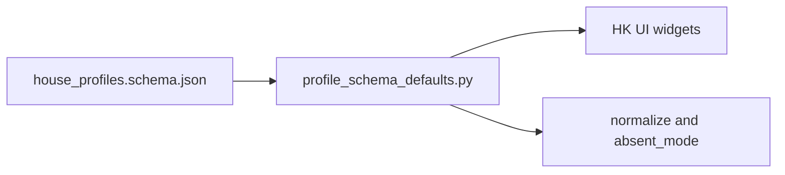

# HK parameter defaults via schema + review

## Decisions (locked)

- **1A:** Defaults live as `"default"` on properties in [share/config/house_profiles.schema.json](share/config/house_profiles.schema.json); a helper loads them for UI + normalizers.
- **2B:** Change Temperaturabsenkung and fix clear UI/normalize inconsistencies in the same change; keep other domain values as today (listed below).

## Current gap

HK soft defaults are duplicated literals in Python (`profiles_thermal_annual.py`, `profiles_store.py`, `optimizer/absent_mode.py`, UI thermal/session/EV helpers). Schema has almost no thermal `"default"` keys and nothing reads them at runtime. Backlog “annual-rc” means `thermal_annual` (Haus Wärme).

## Approach

1. Add `"default"` on every HK field that already has a soft fallback (profile, consumer / thermal_annual, nested thermal_rc_params, nested heat-storage, EV fields that already exist in schema).
2. Add missing schema properties used in code but absent today (`building_mass`, `house_tolerance_c`, `heat_storage`) so defaults have a home.
3. New module [house_config/profile_schema_defaults.py](house_config/profile_schema_defaults.py): load schema once; getters like `consumer_default("absent_temp_reduction_c")`, `profile_default("latitude")`, `thermal_rc_default("setpoint_c")`. Fail loud if a requested key has no `"default"` in schema.
4. Replace hardcoded fallbacks in normalizers + UI with those getters.
5. `thermal_rc` **load path stays strict** (required fields still fail if missing on disk). Schema defaults are for **UI seeding** of empty widgets only.

## Default review — concrete values

### Change in this work

- `absent_temp_reduction_c`: **6.5 → 2.5** (backlog)
- profile `latitude` / `longitude`: store 48.0/10.0 vs UI 48.2/11.0 → both **48.2 / 11.0**
- `living_area_m2`: UI 120 vs normalize 0.0 → both **120.0**

### Keep (same numbers, move into schema `"default"`)

- Profile: `default_pv_tilt` 25, `default_pv_azimuth` 0; UI seed `annual_kwh` 4500 where that seed already exists
- thermal_annual: `target_temp_c` 21.5, `persons` 2, `building_class` 3, `heat_pump_type` `luft`, `heating_limit_c` 15.0, `house_tolerance_c` 0.5, `building_mass` `mittel`, solar area 0 / tilt 18 / azimuth 0, `min_on_quarterhours` 1; heat storage when present: loss 0.02, setpoint 45, tolerance 5
- thermal_rc (UI seed only): volume 6000 L, setpoint 36.5, tolerance 1.0, heat_loss 0.1, efficiency 0.95, `min_on_quarterhours` 8
- EV: keep current `_default_ev_consumer()` numbers; add schema defaults only for EV fields already on the consumer/schedule schema

### Unchanged semantics

- Legacy `absent_temp_c` → reduction delta stays (e.g. 21.5−15 = 6.5). Only the “key missing” path becomes 2.5.
- Profiles that already saved `6.5` keep 6.5 (no migration rewriting saved values).

## Files to touch

- [share/config/house_profiles.schema.json](share/config/house_profiles.schema.json) — add `"default"` (+ missing props)
- [share/config/house_profiles.example.json](share/config/house_profiles.example.json) — `absent_temp_reduction_c: 2.5`
- New: `house_config/profile_schema_defaults.py`
- Wire: `profiles_thermal_annual.py`, `profiles_store.py`, `optimizer/absent_mode.py`, UI thermal/session (EV seeds if schema-covered)
- Tests: helper unit tests; update missing-key absent default asserts; keep legacy-migration test expecting 6.5
- Docs: only if a user doc quotes the numeric default (handbook currently does not)
- Backlog: archive the Minor-changes item after implementation

## Out of scope

- Config migration step for existing saved `6.5` values
- Soft-filling required `thermal_rc` fields on normalize
- Components / PV-battery sidecar defaults (`components.schema.json`)
