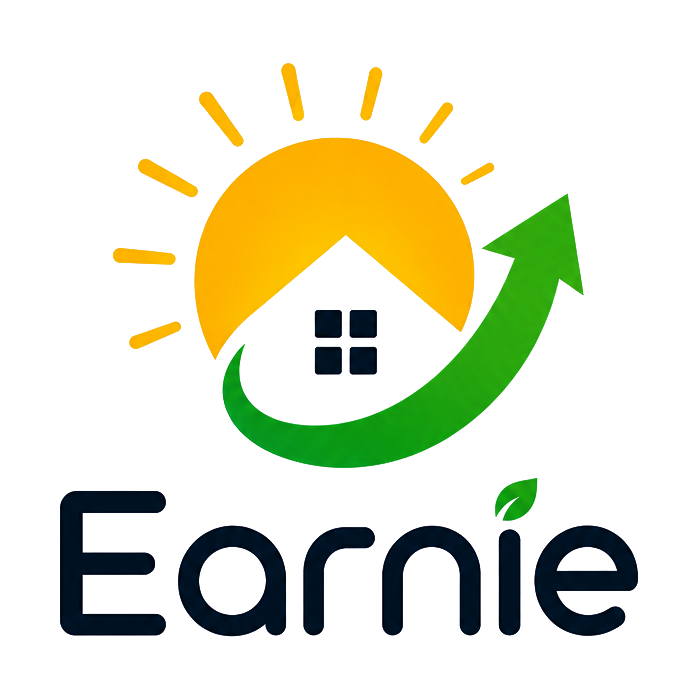
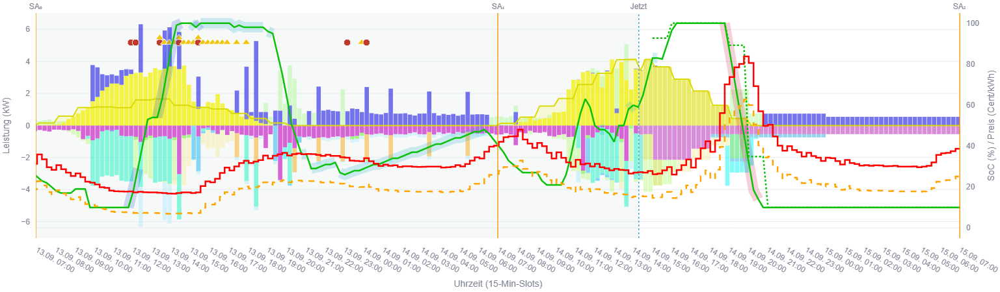

# Earnie

  

**Earnie** optimiert den Energiefluss im Smart-Home. Speicher, PV und Verbraucher mit wählbaren Schaltzeiten werden so eingeplant, dass die Stromkosten sinken und der Eigenverbrauch steigt. Daemon und MILP-Plan arbeiten im **15-Minuten-Takt** (Viertelstunden-Slots). Seine Stärke spielt **Earnie** vor allem bei [Spot-Tarifen (im DACH-Raum)](https://www.epexspot.com/) aus. Eine umfangreiche Oberfläche zeigt genau, was **Earnie** gemacht hat und was er plant.

Wie hoch das Einsparpotenzial ist, kann **Earnie** vorab für ein ganzes Jahr hochrechnen, auch ganz ohne Smart-Home.

Earnie arbeitet unabhängig von Energie- und Systemlieferanten.

GitHub-Repository: [JochenTCC/Earnie](https://github.com/JochenTCC/Earnie).

## Was ist Earnie?

**Earnie** richtet sich an Hausbesitzer:innen, die ihre Stromkosten minimieren möchten, insbesondere bei [Spot-Tarifen](https://www.epexspot.com/). In einem variablen Zeitfenster von max. 48 h plant Earnie Verbräuche und Erträge so, dass die Kosten minimal sind.

Am besten funktioniert das bei Häusern mit PV-Anlage, Batteriespeicher und Verbrauchern, die sich per Smart-Home steuern lassen: smarter Wechselrichter, smarte Wallbox für das E-Auto, smarte Wärmepumpe und weitere Geräte. Für Geräte ohne smarte Freigabe kann **Earnie** Startempfehlungen geben.

Die Live-Anbindung läuft über **EHAL**. Das Backend wird per Config umgeschaltet ([Smarthome-Backend wählen](docs/einrichtung/smarthome-backend-wahl.md)):

- **[Loxone](https://www.loxone.com/dede/):** Standard-Backend.
- **Pfad A2 (DACH):** [Home Assistant](https://www.home-assistant.io/) + [evcc](https://evcc.io/).
- **OpenEMS:** Prototyp für Lab und Industrie.

Der große Hebel für Einsparungen liegt im geschickten Timing all dieser Verbraucher und im intelligenten Einsatz des Batteriespeichers als Puffer.

*Was-wäre-wenn-Analyse: vorab sehen, was eine andere Konfiguration sparen könnte*

Statt fester Regeln (wie bei anderen Lösungen) berechnet **Earnie** einen **Plan für die nächsten 24 bis 48 Stunden**. Dabei berücksichtigt er Strompreise, PV-Prognose, Wettervorhersagen für den Standort des Hauses, Speicherzustand und Gerätebedarf. Ein dauerhaft laufender Daemon setzt den Plan über EHAL um. Eine übersichtliche Web-Oberfläche zeigt Soll- und Ist-Werte und hilft bei Konfiguration und Analyse.

| Komponente                                 | Rolle                                                                                           |
| ------------------------------------------ | ----------------------------------------------------------------------------------------------- |
| `main.py`                                  | Liest Telemetrie über EHAL, optimiert und schreibt Steuerwerte; läuft dauerhaft.               |
| **[Streamlit](https://streamlit.io/)-App** | Cockpit, Planung, Simulation; läuft optional parallel und steuert die Anlage nicht.            |

Details: [Betrieb](docs/einrichtung/betrieb.md)

## Was bringt Earnie?

- **Günstiger laden und heizen:** Earnie nutzt günstige Stunden und PV-Überschuss, statt wie mit einer Flatrate zu planen.
- **Speicher sinnvoll nutzen:** SOC-Ziele und Entladestrategie folgen dem Tagesverlauf, statt nur zwischen „voll“ und „leer“ zu wechseln.
- **Flexible Geräte intelligent einplanen:** Earnie plant E-Auto, Wärmepumpe und SwimSpa-Filter ein; für manuelle Geräte gibt es Empfehlungen.
- **Transparenz:** Der Monitor (Sunset-2-Sunset) zeigt Vergangenheit, Live-Snapshot und Vorausschau in einem Cockpit.
- **Was-wäre-wenn ohne Risiko:** Die Szenario-Exploration vergleicht Varianten, ohne den Produktivbetrieb zu ändern. So lassen sich unnötige oder falsche Investitionen und die Wahl des falschen Stromtarifs vermeiden.

## Funktionen

### Optimierung und Steuerung

- Earnie optimiert Speicher und Verbraucher gemeinsam im 15-Minuten-Takt. Ob Earnie oder die Nutzer:innen die Verbraucher aktivieren, ist wählbar.
- Dynamische Strompreise (z. B. [aWATTar](https://www.awattar.at/)) und eine Preis-Prognose über die veröffentlichten Preise hinaus fließen in den Plan ein.
- Die PV-Erzeugungsprognose kommt von [forecast.solar](https://forecast.solar/). Außen- und Klimadaten liefert [Open-Meteo](https://open-meteo.com/); sie dienen den thermischen Modellen und der temperaturabhängigen Grundlast.

### Verbraucher

- **E-Auto über Wallbox:** Das Smarthome gibt vor, wann das E-Auto voll sein soll; um den Rest kümmert sich Earnie.
- **Wärmepumpe:** Ein Wärmemodell des Hauses sagt den Wärmebedarf anhand der Wetterdaten voraus. Die Optimierung berücksichtigt diesen Bedarf.
- **Pool:** Auch hier arbeitet ein Wärmemodell wie bei der Wärmepumpe. Filter lassen sich zusätzlich bedarfsgerecht aktivieren.
- **Generische Geräte:** Waschmaschine, Trockner, Geschirrspüler und ähnliche Geräte.

### Oberfläche (Weboberfläche über [Streamlit](https://streamlit.io/))

- **Monitor** (mit vollem Optimierungs-Horizont): Energiefluss, SOC-Verlauf der Batterie, Verbraucherverhalten und die Lade-Kontrolle der Batterie durch Earnie.
- **Hauskonfigurator / Szenarienkonfigurator:** umfangreiche Konfiguration des Hauses mit allen Verbrauchern für Planung und Szenario-Exploration.
- **Manuelle Geräte:** Laufzeiten mithilfe von Earnie planen und Empfehlungen annehmen.
- **Szenario-Explorer:** Szenarien vergleichen (Was-wäre-wenn-Analysen).
- **Analyse Verbrauch & Kosten:** Verbrauch, Herkunft und Kosten aus dem Produktiv-Log sowie der Vergleich SwimSpa autonom gegenüber Earnie.

### Betrieb

- [Docker](https://www.docker.com/) auf [Synology](https://www.synology.com/), [LoxBerry](https://www.loxberry.com/), [Proxmox](https://www.proxmox.com/) LXC oder PC; weitere Systeme folgen bei Bedarf.
- **Home-Assistant-Add-on** (HA OS / Supervised): [docs/einrichtung/homeassistant-addon.md](docs/einrichtung/homeassistant-addon.md)
- **Optimierer-Dienst** in Streamlit: Start, Stopp und Neustart von `main.py` in der UI; ein Docker-Container (`earnie-productive`) mit Auto-Start.
- Persistente Laufzeitdaten sorgen für Nachvollziehbarkeit und ermöglichen Debug-Dumps.
- Optionale anonyme **Nutzungsstatistik** (opt-in): [Betrieb – Nutzungsstatistik](docs/einrichtung/betrieb.md#nutzungsstatistik)

*Earnie Monitor: der gesamte Optimierungs-Horizont mit Energiefluss, SOC und Verbraucherverhalten.*

## Typischer Ablauf

1. **Voraussetzungen klären:** Smarthome-Backend (Loxone, HA + evcc oder OpenEMS-Lab), PV und Speicher, verschiebbare Verbraucher, optional ein dynamischer Tarif.
2. **Deployment wählen:** Container ([Synology](https://www.synology.com/) / [LoxBerry](https://www.loxberry.com/) / [Proxmox LXC](docs/einrichtung/proxmox-lxc.md) / [VMware `vctl`](docs/einrichtung/vmware-vctl.md)) oder lokaler Betrieb. Details: [Container](docs/einrichtung/container.md) · [Betrieb](docs/einrichtung/betrieb.md)
3. **Konfiguration anlegen:** Bootstrap von `earnie_env/config/`, Backend und Mapping. Siehe [Erste Schritte](docs/README.md#erste-schritte) · [Smarthome-Backend wählen](docs/einrichtung/smarthome-backend-wahl.md)
4. **Was-wäre-wenn-Analyse:** Mit der Erstkonfiguration klären, ob sich ein Gesamtsystem und Earnie im produktiven Einsatz lohnen.
5. **Verbindung zum Smarthome herstellen:** zuerst die Seite **Smarthome-Backend** (Auswahl und Erkennung), danach **EHAL-Com** (Live-Lesen). Bei Loxone optional `python -m scripts.verify_loxone_setup` ausführen.
6. **Produktiv starten:** `python main.py` dauerhaft betreiben (**nur eine Instanz**) bzw. Docker mit Auto-Start nutzen.
7. **Monitor öffnen:** [Streamlit](https://streamlit.io/) im Browser aufrufen. Den Port je Stack nennt [Streamlit-Ports](docs/dev/streamlit-ports.md) (Prod und lokale venv typisch **8501**).
8. **Feintuning:** Hausprofil, Szenarien und flexible Verbraucher über die Planungs- und Betriebsseiten anpassen.

Optional: [Greenfield Dev-Stack](docs/einrichtung/greenfield-dev-stack.md) (Ersteinrichtung)

## Anwender-Dokumentation

- **Benutzer-Handbuch (Einstieg aus Anwendersicht):** [docs/user-manual/Benutzer-Handbuch-Earnie.md](docs/user-manual/Benutzer-Handbuch-Earnie.md)
- **Technische Anwender-Doku** (Einrichtung, Konfiguration, UI, Loxone): **[docs/README.md](docs/README.md)**, inkl. [Erste Schritte](docs/README.md#erste-schritte)

| Bereich                | Kapitel                                                                                                                                                                                                          |
| ---------------------- | ---------------------------------------------------------------------------------------------------------------------------------------------------------------------------------------------------------------- |
| **Handbuch**           | [Benutzer-Handbuch Earnie](docs/user-manual/Benutzer-Handbuch-Earnie.md)                                                                                                                                         |
| **Einrichtung**        | [Smarthome-Backend wählen](docs/einrichtung/smarthome-backend-wahl.md) · [Loxone-Anbindung](docs/einrichtung/loxone-anbindung.md) · [HA + evcc](docs/einrichtung/ha-evcc.md) · [HA-Add-on](docs/einrichtung/homeassistant-addon.md) · [Betrieb](docs/einrichtung/betrieb.md) · [Container](docs/einrichtung/container.md) · [Proxmox LXC](docs/einrichtung/proxmox-lxc.md) · [VMware `vctl`](docs/einrichtung/vmware-vctl.md) |
| **Konfiguration**      | [Überblick](docs/konfiguration/overview.md) · [PV & Batterie](docs/konfiguration/batterie-pv.md) · [Flexible Verbraucher](docs/konfiguration/flexible-verbraucher.md) · [Preise](docs/konfiguration/preise.md) |
| **Benutzeroberfläche** | [Betriebsmodi](docs/ui/betriebsmodi.md) · [Charts](docs/ui/charts.md) · [Smarthome-Backend](docs/ui/smarthome-backend.md) · [EHAL-Com](docs/ui/ehal-com.md)                                                                                            |
| **Referenz**           | [Abkürzungen](docs/referenz/abbreviations.md) · [Loxone-Signale und Earnie-Library](docs/referenz/loxone-signals.md)                                                                                                                                                                |

## Installation und Betrieb

| Weg                                         | Für wen                                                                                                               | Detail                                                                                                             |
| ------------------------------------------- | --------------------------------------------------------------------------------------------------------------------- | ------------------------------------------------------------------------------------------------------------------ |
| **Docker (empfohlen für den Produktivbetrieb)** | [Synology](https://www.synology.com/), [LoxBerry](https://www.loxberry.com/), [Proxmox](https://www.proxmox.com/) LXC | [docs/einrichtung/container.md](docs/einrichtung/container.md) · [proxmox-lxc.md](docs/einrichtung/proxmox-lxc.md) |
| **Home-Assistant-Add-on**                   | HA OS / Supervised (z. B. Home Assistant Green)                                                                       | [docs/einrichtung/homeassistant-addon.md](docs/einrichtung/homeassistant-addon.md)                                 |
| **VMware `vctl` (Windows-PC)**              | VMware Workstation Pro/Player, kein Docker Desktop                                                                    | [docs/einrichtung/vmware-vctl.md](docs/einrichtung/vmware-vctl.md) · `scripts/run_earnie_vctl.ps1`                    |
| **Lokal (Dev / ohne Container)**            | Entwickler:innen, Tests                                                                                               | [DEVELOPER.md](DEVELOPER.md)                                                                                       |

## Roadmap (Kurz)

- **2.7:** Mehrspeicher, Exportbegrenzung, Binding-Komfort; erste Alpha-Qualitätsprüfung (siehe Backlog).
- **2.8:** Edbert-Tarife, Regression-Gate, Monitor-Charts (siehe Backlog).
- **Parameter-Anpassung:** PV- und thermische Parameter passen sich über die Zeit an.
- **Gekoppelte thermische Modelle:** Haus-, Speicher- und Solar-Modelle werden miteinander gekoppelt.
- **Smartere Geräte-Empfehlungen:** adaptive Leistung und Laufzeit für Haushaltsgeräte.

Earnie wird weitgehend mithilfe von [Cursor](https://cursor.com/) entwickelt.

Vollständige Roadmap: **[backlog/Backlog.md](backlog/Backlog.md)**

## Lizenz

Die Software ist **Source-Available** und auf **private, nicht-kommerzielle Nutzung** beschränkt. Vollständige Bedingungen: **[LICENSE.md](LICENSE.md)**.

## Für Entwickler

Wir freuen uns sehr über Ihre Unterstützung, vor allem bei der Einbindung weiterer Systeme und beim Ausprobieren – vielen Dank!

Mitwirken (Lizenz, Forks, Hardware-Profile, Kontakt): **[CONTRIBUTING.md](CONTRIBUTING.md)**  
Projektstruktur, lokale Entwicklung, Container-Build und technische Hinweise: **[DEVELOPER.md](DEVELOPER.md)**
