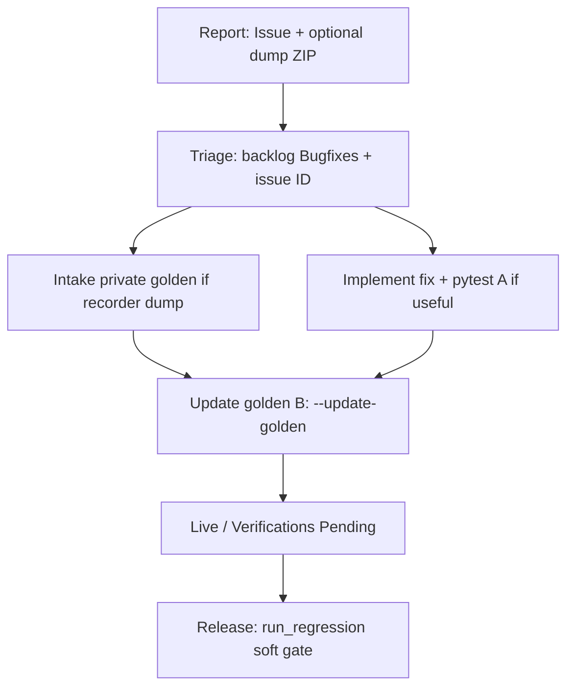

# Draft: Bug → regression case → release workflow

**Status:** Draft (2026-10-15) — maintainer / agent operating model  
**Not yet:** a dedicated Cursor skill; this document is the design target.  
**Related:** [regression-suite.md](../workflow/regression-suite.md), [release-checklist.md](../workflow/release-checklist.md), skill `bugfix-regression-test`, skill `session-abschluss`, `.cursor/rules/backlog.mdc`

## 1. Goal

One guided path from a **customer or production problem** to a **fixed release**, so that:

1. The report is reproducible offline.
2. The fix is verified.
3. The same failure cannot return unnoticed (pytest *and/or* private golden case).
4. The release gate sees the new case (soft today; hard CI in Regression P3).

## 2. What already exists (pieces)

| Piece | Role today |
|---|---|
| GitHub Issues + Streamlit Kontakt | Public intake (ID only; no customer data) |
| Debug-dump ZIP (schema v3 + optional `recorder/`) | Frozen inputs for the incident |
| `backlog/Backlog-Bugfixes.md` 3-step lifecycle | Open → Verifications Pending → Erledigt |
| Skill `bugfix-regression-test` | Soft: propose a **pytest** regression |
| Skill `session-abschluss` | Backlog sync, commit/push, publish choices; reminds pytest regression skill |
| `--intake --private` (Regression P2) | Dump → private L1 case in `Earnie-regression-private` |
| `python -m scripts.run_regression` | Public + private goldens before release |
| Release checklist §1 | Soft gate: suite green, attach report |

**Gap:** no single agent skill chains dump intake → fix → golden update → Verifications Pending → release reminder. This draft defines that chain.

## 3. Two kinds of “regression”

Keep both; do not collapse them.

| Kind | Where | When to use |
|---|---|---|
| **A — Pytest regression** | Public `tests/test_*_regression.py` (or focused module) | Small, scrubbed / synthetic inputs; runs every commit (or fast subset). Prefer for logic bugs that do not need full customer matrices. |
| **B — Release golden case** | Public `tests/regression/cases/` (`REG-O-` / `REG-S-`) or private `Earnie-regression-private` (`REG-<issue>-<slug>`) | Behaviour lock across releases; customer data → **private only**. Runs before release (`run_regression`), not per commit. |

Skill `bugfix-regression-test` today covers **A**. This workflow adds **B** (especially private intake) as a first-class step when a dump with `recorder/` exists.

## 4. End-to-end phases



### Phase 0 — Report

1. Public GitHub issue: symptom, version, **case ID only** once known (`REG-142-…`). No names, addresses, load profiles.
2. Sensitive payload: debug-dump ZIP shared only with the maintainer (dump dialog / `docs/einrichtung/betrieb.md` disclosure).
3. Optional: mail `support@earnie-hems.com` when Issues cannot carry the material.

### Phase 1 — Triage

1. Add / update entry in `backlog/Backlog-Bugfixes.md` (topic chapter).
2. Assign stable alias for any person name (`backlog-anonymize-users.mdc`); never put real names in the public backlog.
3. Decide: needs golden **B** (dump with recorder), pytest **A**, both, or neither (config/hardware-only exception).

### Phase 2 — Archive as case (golden B, when applicable)

```powershell
$env:PYTHONIOENCODING='utf-8'; $env:PYTHONUTF8='1'
.venv\Scripts\python.exe -m scripts.run_regression --intake DUMP.zip `
  --id REG-<issue>-<slug> --private `
  --seed-anchor "..."   # or --cycle-index N
  [--issue JochenTCC/Earnie#N] [--title "..."]
```

Rules (P2 locked):

- `--private` required for customer dumps (never `tests/regression/cases/` / `archive_prod_dump` for personal data).
- Selector required; dump without `recorder/` → fail loud (ask for a newer dump or fall back to pytest **A** only).
- Does **not** write `expected.json` yet.

Commit the new case folder in **`Earnie-regression-private`** (separate from the public Earnie commit).

### Phase 3 — Fix

1. Implement the code fix in Earnie.
2. Apply skill `bugfix-regression-test`: propose pytest **A** (scrubbed / minimal). User may decline with a noted reason.
3. Focused pytest green.

### Phase 4 — Lock the golden (B)

```powershell
.venv\Scripts\python.exe -m scripts.run_regression --update-golden --case REG-<issue>-<slug>
.venv\Scripts\python.exe -m scripts.run_regression --case REG-<issue>-<slug>
```

1. Commit updated `expected.json` in the **private** repo with a one-line justification (behaviour now correct / intended).
2. In Earnie: move backlog item to `## Bugfix Verifications Pending`; note both test paths (pytest file and/or `REG-…`).

### Phase 5 — Live verification → Erledigt

1. After live/prod acceptance: archive to `backlog/Backlog-Erledigt.md` (dated heading).
2. Close or comment on the public issue: “Fixed in v…; guarded by private case REG-… / pytest …”.

### Phase 6 — Release integration

Before tag / publish (checklist §1, soft gate):

```powershell
.venv\Scripts\python.exe -m scripts.run_regression --workers N
```

1. Report must list **Public SHA** + **Private SHA** (or `private-root-missing` skipped — maintainer should have the private clone for a full gate).
2. Attach `backtesting_logs/regression/regression_report.md` to the release notes draft.
3. Red metrics → fix or conscious `--update-golden` with commit rationale before `promote`.
4. P3 (Version 2.8): CI job + deploy key; soft → hard gate decision.

## 5. Agent orchestration (proposed skill)

**Working title:** `bug-to-regression-case` (or extend `bugfix-regression-test` with a “golden B” branch).

Suggested checklist the agent walks with the user:

```text
Bug → release:
- [ ] 0. Issue URL / backlog entry / dump path known?
- [ ] 1. Triage: pytest A / golden B / both / exception
- [ ] 2. If B: --intake --private + selector; commit private case
- [ ] 3. Fix code; propose pytest A
- [ ] 4. --update-golden for REG-…; private commit
- [ ] 5. Move to Verifications Pending (note paths)
- [ ] 6. After live OK: Erledigt + issue comment
- [ ] 7. Remind: run_regression before next publish (session-abschluss Phase 2 / checklist)
```

**session-abschluss hooks (proposed):**

- If the session did a code bugfix: keep soft pytest skill; **additionally** ask whether a private golden was intaken / needs commit+push on `Earnie-regression-private`.
- On publish path (**B** / **C**): remind regression suite + private SHA (already on checklist; make the skill say it explicitly).

## 6. Privacy and IDs

- Public issue / public Earnie tree: case ID and scrubbed pytest fixtures only.
- Private repo: raw customer recorder + `source: customer`, `anonymized: false`.
- Case ID: `REG-<issue>-<slug>` for issue-driven private cases; `REG-O-` / `REG-S-` for own/synthetic public cases.
- Customer ↔ alias mapping stays local (same map as backlog anonymization); never commit real-name maps.

## 7. Out of scope for this draft

- Scrubber customer → public repro (Regression P3).
- L3 live-replay window cut from recorder.
- Hard CI gate / deploy-key checkout of the private repo.
- Auto `--update-golden` during intake.
- Legal/consent prose beyond existing dump disclosure.

## 8. Open points for review

1. One new skill vs. extending `bugfix-regression-test` — prefer **extend** (one soft gate) or **new skill** (clearer golden path)?
2. Should session-abschluss **block** publish reminders until private SHA is present when any Verifications Pending item cites a `REG-\d+-` case?
3. Minimum bar: every customer dump with recorder → always create golden B, or only when the bug is optimizer/plan-related?

---

_When accepted: wire skill + backlog cross-links; keep this file as the durable SoT or fold §4–5 into regression-suite.md / release-checklist.md and delete the draft._
