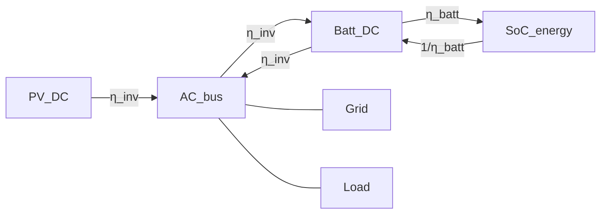
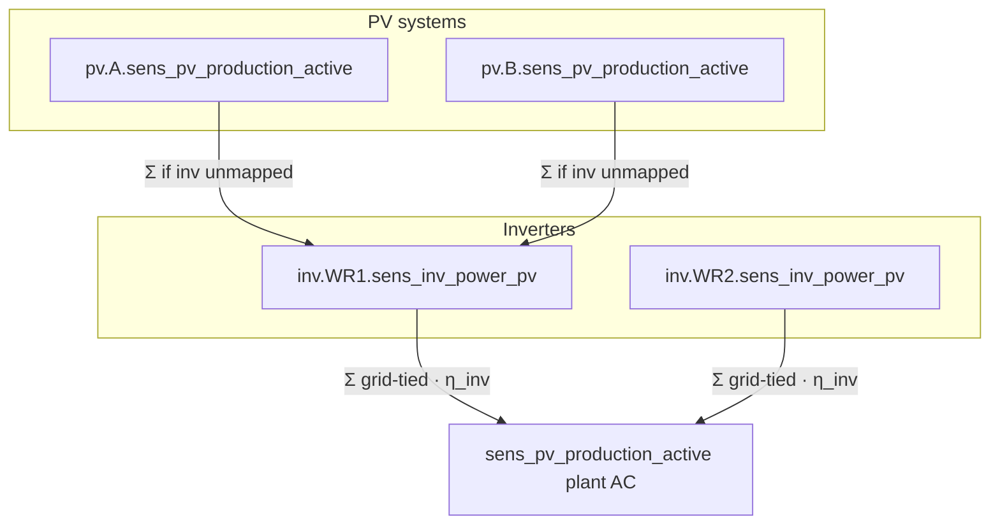

# Conversion losses (inverter + battery) — design note

**Status:** Phase 1 (AC-path η_inv / η_batt) **implemented**. Multi-inverter live PV attribution **implemented** (derive + first `pv.{id}.*`; curtailment still forecast weights).  
**Origin:** Inverter follow-ups after **2.7.l** (epic **Inverter**)  
**Related:** [`ehal.md`](../../referenz/ehal.md) (plant PV sum + derive), [`optimizer/milp_horizon.py`](../../../optimizer/milp_horizon.py), [`optimizer/milp_inverter.py`](../../../optimizer/milp_inverter.py), [`integrations/pv_attribution.py`](../../../integrations/pv_attribution.py)

## Guiding principle

Keep it simple — this is a **simulation** for planning, not a datasheet lab model. Prefer transparent path losses over efficiency curves, MIQP, or a full DC-bus formulation. Real I²R (∝ P²) and manufacturer curves stay out of scope for v1.

## Problem today

House ESS uses one one-way factor `battery_efficiency` → MILP key `efficiency`:

```text
e[t] = e[t−1] + (P_chg · η − P_dis / η) · dt_h
```

Round-trip energy factor ≈ **η²**. `P_chg` / `P_dis` sit on the house **AC** balance; η never appears as an AC loss term.

Inverter MILP ([`milp_inverter.py`](../../../optimizer/milp_inverter.py)) applies DC/AC **clipping** only (`pv_dc` → AC clip). DC↔AC conversion efficiency is explicitly deferred.

**Side effect:** PV→load and grid↔load through the inverter are lossless; only storage cycling is punished. The solver therefore under-penalises “use the inverter, avoid the battery” relative to reality. When inverter losses are introduced, battery chemistry η should be **higher** than today’s lumped value, because part of today’s η already stands in for the inverter.

Live plant PV is bare `sens_pv_production_active` (AC). Optional `inv.{id}.sens_inv_power_pv` and `pv.{pv_system_id}.sens_pv_production_active` feed post-read attribution (see § Multi-inverter live attribution).

## Phase 1 model — AC-path losses only

Hybrid and AC-coupled plants use the **same** conversion losses. A true shared-DC shortcut (PV→battery without paying η_inv) is a later refinement only.



### Abstract resistance (linear)

On each conversion edge with throughput `P ≥ 0`:

```text
P_loss = r · P          with  0 ≤ r < 1
η      = 1 − r          one-way factor
```

This is still constant η, but framed as a **path resistance** so losses apply to whatever flows on that edge (PV, charge, discharge), not only battery SoC.

### Two factors

| Factor | Owns | Typical seed |
|--------|------|----------------|
| `η_inv` / `r_inv` | DC↔AC on the inverter | ~0.97 (`r` ≈ 0.03) |
| `η_batt` / `r_batt` | Chemistry into/out of SoC | higher than today’s lumped η |

Effective AC↔SoC one-way factor: **η_path = η_inv · η_batt** (same shape as today’s single η, but PV→AC also pays `η_inv`).

### Prescribed formulas (for a later implementation)

```text
SoC:     e += (P_chg · η_inv · η_batt − P_dis / (η_inv · η_batt)) · dt_h
PV AC:   P_pv_ac = P_pv_dc · η_inv     (then existing AC clip)
```

`standby_power_kw` stays a separate constant AC load (not folded into `r`).

EV `charging_efficiency` and thermal `heating_efficiency` remain **separate** device paths (out of this inverter/ESS split).

## Migration of `battery_efficiency`

When efficiency is implemented:

1. Treat today’s config value as **lumped path** η_old ≈ η_inv · η_batt (one-way, matching code). UI wording “Roundtrip-Wirkungsgrad” is already slightly wrong relative to round-trip ≈ η².
2. Default `η_inv` from the inverter (or a global seed); set `η_batt = η_old / η_inv` (clamp to (0, 1]).
3. Fail loud on inconsistent inputs — no silent dual-read of old + new shapes.
4. Docs/UI: clarify one-way factors. The measured-η helper (`√(E_dis/E_chg)` in `ui/consumer_cost_battery_metrics.py`) still includes inverter until live/plan metrics are split.

## Multi-inverter live attribution of `sens_pv_production_active`

**Implemented** in [`integrations/pv_attribution.py`](../../../integrations/pv_attribution.py) + `prepare_live_telemetry` in [`integrations/ehal_live.py`](../../../integrations/ehal_live.py).

### Topology

Each PV system has one `inverter_id`. Aggregation is **PV systems → inverter → plant** (not plant `pv.meter.*`). One plant grid meter (`grid.meter.*`) stays the AC summary at the grid boundary. Multi-ESS unchanged.

### Behaviour

| Topic | Choice |
|-------|--------|
| Direction | Derive plant from Σ when plant unmapped; **split helper** `attribute_plant_pv_to_inverters_w` shipped for later curtailment |
| Inv from PVs | If `inv.{id}.sens_inv_power_pv` missing, Σ all attached `pv.{id}.sens_pv_production_active` (fail loud on partial) |
| Plant from invs | Σ grid-tied inv PV · **η_inv** (island excluded); fail loud if any eligible inv lacks PV |
| Incomplete maps | **Fail loud** (no soft Σ over a subset) |
| Curtailment weights | Still **forecast** shares in `allocate_inv_ac_limits_kw` — live weights are a **follow-up** |
| `pv.*` namespace | Entity-scoped `pv.{pv_system_id}.sens_pv_production_active` on `pv_systems[].ehal_bindings` |
| Plant required | Optional when derive coverage is complete; otherwise still required |
| Ownership | Post-read helper (not per adapter) |



### Follow-up

- Switch curtailment allocation to live inv PV weights (use `attribute_plant_pv_to_inverters_w`).

## Out of scope (v1 model)

- DC-bus hybrid shortcut (PV→battery without η_inv)
- P² / curve-based efficiency
- Device catalog presets for η
- Live curtailment weights (follow-up above)
- `pv.meter.*` / renaming bare plant energy counters

## Pointers

- EHAL plant PV sum and optional Σ derive: [`ehal.md`](../../referenz/ehal.md) § PV / out of scope
- Inverter entity draft (historical): [`backlog/EHAL-Inverter-Draft.md`](../../../backlog/EHAL-Inverter-Draft.md)
- Backlog: Inverter follow-ups in [`backlog/Backlog.md`](../../../backlog/Backlog.md)
