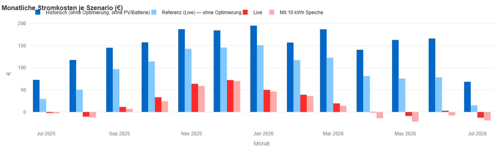
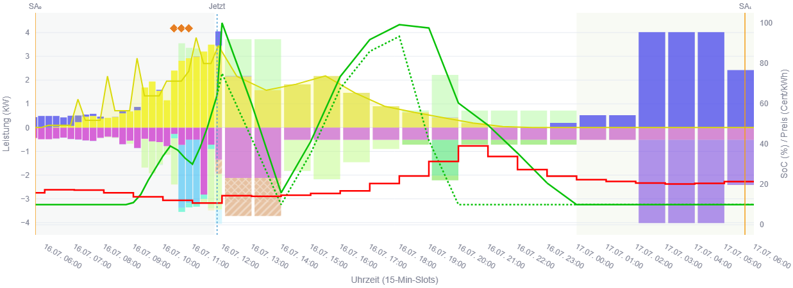

# Earnie – Benutzer-Handbuch

Dieses Handbuch beschreibt Earnie aus Sicht der Anwendung: vom ersten Start über die Was-wäre-wenn-Analyse bis zum Live-Betrieb.

- Technische Details (Container, Config-Schema, Entwicklung): [Anwender-Dokumentation](../README.md) und [README](../../README.md)
- Kurzformen wie EHAL, SE oder SoC: [Abkürzungen](../referenz/abbreviations.md)

---

## Übersicht

### Wofür ist Earnie gedacht?

**Earnie** ist ein Energie-Optimierer für Privathaushalte. Er plant und steuert, wann Strom bezogen, gespeichert, verbraucht oder eingespeist wird. Das Ziel: niedrigere Stromkosten und mehr Eigenverbrauch.

Am meisten bringt Earnie bei **dynamischen Spot-Tarifen** (z. B. aWATTar), deren Preise sich stündlich oder viertelstündlich ändern. Statt fester Regeln berechnet Earnie regelmäßig einen **Plan für die nächsten 24 bis 48 Stunden**. Dabei berücksichtigt er:

- aktuelle Strompreise (und eine Prognose, falls die Börse noch keine Preise veröffentlicht hat),
- die PV-Ertragsprognose aus dem Wetter am Standort,
- Ladezustand und Grenzen des Batteriespeichers,
- steuerbare Verbraucher wie E-Auto, Wärmepumpe, Pool und Haushaltsgeräte.

Earnie lässt sich auf zwei Arten nutzen:

| Nutzung | Zweck |
| ------- | ----- |
| **Was-wäre-wenn (ohne Smarthome)** | Haus und Varianten konfigurieren und einen Jahresvergleich rechnen – z. B. ob sich ein Speicher, eine größere PV-Anlage oder ein Spot-Tarif lohnt. |
| **Live-Betrieb (mit Smarthome)** | Dauerhaft optimieren und Sollwerte an Loxone, Home Assistant (+ evcc) oder OpenEMS (Lab) schreiben. Der Monitor zeigt Plan und Ist-Werte. |

Im Hintergrund steuert allein der **Optimierer-Dienst** die Anlage. Die Web-Oberfläche (Streamlit) dient als Cockpit für Anzeige, Konfiguration und Analyse. Dort lässt sich der Optimierer-Dienst auch starten, stoppen und neu starten.

### Voraussetzungen

**Für die Was-wäre-wenn-Analyse (ohne Live-Steuerung):**

- PC oder Server mit Docker oder einer lokalen Python-Umgebung
- Webbrowser für die Oberfläche
- grobe Angaben zu Haus, Verbrauchern, Strom-Tarif(en) und – falls vorhanden – PV und Speicher
- Internetzugang für Wetter- und Preisdaten (je nach Szenario)

**Für den Live-Betrieb zusätzlich:**

- ein erreichbares Smarthome-Backend: [Loxone](https://www.loxone.com/) (Standard), [Home Assistant](https://www.home-assistant.io/) + evcc oder OpenEMS (Lab-/Industrie-Prototyp). Welches passt, erklärt [Smarthome-Backend wählen](../einrichtung/smarthome-backend-wahl.md).
- Signale bzw. Entities für Ladezustand, Leistungen, Freigaben und Sollwerte (siehe [Verbindung zum Smarthome](#verbindung-zu-smarthome))
- in der Regel PV und/oder Batteriespeicher sowie steuerbare Verbraucher
- empfohlen: ein dynamischer Bezugs- und/oder Einspeisetarif

Earnie ist unabhängig von Energieversorger und Systemlieferant.

### Lizenzbedingungen

Earnie ist **Source-Available** und für die **private, nicht-kommerzielle Nutzung** in Privathaushalten vorgesehen. Kommerzielle Nutzung, Weiterverkauf und SaaS-Angebote sind nur mit schriftlicher Zustimmung erlaubt.

Die Software wird „wie besehen“ bereitgestellt. Eingriffe in Speicher und Großverbraucher erfolgen auf eigenes Risiko.

Für alle, die Konfiguration und Wartung nicht selbst übernehmen möchten, sind kommerzielle Angebote geplant.

Vollständige Bedingungen: [LICENSE.md](../../LICENSE.md).

### Banner der Wahrheit

Ein kurzes Attributions-Banner kennzeichnet Earnie und seine Nutzungsbedingungen: Name, Hinweis auf die nicht-kommerzielle Nutzung, Link zum offiziellen Repository und Version. Es erscheint in der Sidebar unter **Info / About** (unten) und zusätzlich am unteren Ende des Hauptbereichs.

Bei erkennbar inoffiziellen oder veränderten Builds (z. B. abweichende Git-Remote) kann zusätzlich ein Warnhinweis erscheinen. Das Banner ist bewusst gut sichtbar.

Unter **Info / About** stehen außerdem der vollständige **Hardware-Fingerprint** (kopierbar) und der Registry-Status (`unbound`, `valid` bzw. gebunden, `mismatch` oder `invalid_sig`). Die Registry ist optional und blockiert den Start nicht.

### Hardware-Registry (`earnie_registry.json`)

Die Datei `earnie_registry.json` bindet eine Earnie-Installation einmalig an ihren Hardware-Fingerprint (Host und optional Smarthome-IDs). Ohne diese Datei bleibt die private Nutzung möglich; der Status lautet dann `unbound`.

Die signierte Datei lässt sich **nicht selbst erzeugen**. Earnie berechnet nur den Fingerprint, die Datei stellt das Earnie-Projekt aus (derzeit per E-Mail, später ggf. über ein Cloud-Portal). Offizielle Images prüfen die Signatur mit einem öffentlichen Schlüssel; der private Schlüssel bleibt beim Aussteller.

**Datei anfordern:**

1. Earnie starten (Docker oder lokal).
2. In der Sidebar **Info / About** öffnen und den vollständigen, 64-stelligen **Hardware-Fingerprint** kopieren (Anzeige als Code-Block).
3. Alternativ auf dem Host (Projektwurzel, mit Python-Umgebung):
   ```text
   python -m scripts.print_hardware_fingerprint
   ```
   Die Ausgabe enthält `fingerprint=` (vollständig) und `fingerprint_display=` (Kurzform).
4. Über **Info / About → Registry per E-Mail anfordern** an `support@earnie-hems.com` senden. Betreff („Earnie Registry“), Fingerprint und Datenschutzhinweis sind im Mailtext bereits enthalten.
   - Die Speicherung der Absenderadresse für Supportzwecke ist standardmäßig aus (**Nein**, DSGVO); bei Bedarf auf **Ja** stellen.
   - Optional die Kontakt-ZIP über **Privater Support** anhängen – nicht in öffentlichen GitHub-Issues.
5. Die Antwort enthält die Datei `earnie_registry.json`.
6. Datei ablegen:

   | Installation | Ablageort |
   | ------------ | --------- |
   | Docker / typisch | `earnie_env/runtime/earnie_registry.json` |
   | eigener Runtime-Pfad | Ordner aus `EARNIE_RUNTIME_PATH` bzw. `…/runtime/` |
   | abweichender Pfad | Umgebungsvariable `EARNIE_REGISTRY_PATH` auf die Datei setzen |

7. Oberfläche neu laden und unter **Info / About** prüfen. Die Registry sollte als `valid` erscheinen.
   - **mismatch:** Fingerprint und Datei passen nicht mehr zusammen (z. B. anderer Host) – neuen Fingerprint senden und die Datei neu anfordern.
   - **invalid_sig:** Die Datei ist beschädigt oder nicht gültig signiert – neu anfordern.

   In beiden Fällen startet Earnie trotzdem (weiche Prüfung).

**Inhalt der Datei (kurz):** Fingerprint, Ausstellungszeit, optional ein Ablaufdatum, Aussteller und eine Ed25519-Signatur. Eine selbst gebaute Datei ohne passende Signatur ist ungültig (`invalid_sig`).

Technische Aussteller-Anleitung: Earnie-Projekt `Entwicklungsplan/Hardware-Registry-Ausstellung.md`.

### Support

- **Kontakt in der App:** In der Sidebar unter **Info / About** Art, Thema und Beschreibung eintragen, dann **GitHub-Issue öffnen**. Issues sind öffentlich, daher gehören keine Zugangsdaten oder andere Geheimnisse hinein. Optional stellt **Informationen in ZIP sammeln** eine ZIP zusammen, die lokal bleibt.
- **Registry und Vertrauliches:** Expander **Privater Support** an `support@earnie-hems.com`.
- **Projekt und Issues:** [GitHub – JochenTCC/Earnie](https://github.com/JochenTCC/Earnie/issues)
- **Website:** [earnie-hems.com](https://earnie-hems.com)
- **Community:** z. B. Diskussionen im Loxone-Umfeld (LoxForum u. Ä.)
- **Technische Doku:** [docs/README.md](../README.md)

Einen vertraglichen Herstellersupport gibt es derzeit nicht. Umso mehr freuen wir uns über Ihre Rückmeldungen – gerade zu Hardware-Typen und Konfigurationen, die wir noch nicht kennen. Jeder Hinweis hilft, Earnie für alle besser zu machen.

---

## Installation

Die typischen Wege im Überblick:

| Weg | Für wen | Hinweis |
| --- | ------- | ------- |
| **Docker (empfohlen für den Produktivbetrieb)** | Synology NAS, LoxBerry, Proxmox LXC, PC (auch VMware `vctl`) | Persistente Ordner `earnie_env/config/` und `earnie_env/runtime/` außerhalb des Images |
| **Greenfield / Ersteinrichtung** | erste Was-wäre-wenn-Tests auf dem eigenen Rechner | eigener Stack, oft Port **8502** – getrennt vom Produktivsystem |
| **Lokal ohne Container** | Entwicklung, Tests | siehe [DEVELOPER.md](../../DEVELOPER.md) |

**Typischer Ablauf mit Docker:**

1. Projekt bzw. Compose-Datei bereitstellen und die Verzeichnisse `earnie_env/config/` und `earnie_env/runtime/` anlegen.
2. Container starten. Fehlende Dateien legt Earnie beim ersten Start an (Bootstrap).
3. Oberfläche im Browser öffnen (im Produktivbetrieb meist Port **8501**, siehe [Streamlit-Ports](../referenz/streamlit-ports.md)).
4. Für den späteren Live-Betrieb: auf der Seite **Smarthome-Backend** das Backend wählen und den Zugang hinterlegen ([Smarthome-Backend wählen](../einrichtung/smarthome-backend-wahl.md)). Danach mit dem Hauskonfigurator weitermachen.

Details: [Container](../einrichtung/container.md) · [VMware `vctl` (Windows-PC)](../einrichtung/vmware-vctl.md) · [Betrieb](../einrichtung/betrieb.md) · [Greenfield](../einrichtung/greenfield-dev-stack.md)

Nach dem ersten Start zeigt die Navigation vor allem **Konfiguration** und **Daemon Control**. Weitere Seiten wie Monitor oder Szenario-Explorer erscheinen, sobald die Einrichtung weit genug ist.

---

## Erste Einrichtung (für die Was-wäre-wenn-Analyse)

In dieser Phase wird das Haus so abgebildet, dass Earnie **Vergleichsszenarien** rechnen kann – noch ohne echte Steuerung der Anlage. Das eignet sich, um Investitionen und Tarifwahl vorab zu prüfen oder um Earnie kennenzulernen.

Empfohlene Reihenfolge:

1. **Hauskonfigurator:** Haus, Verbraucher, PV und Speicher anlegen.
2. **Szenarienkonfigurator:** Varianten bilden (mit/ohne Speicher, anderer Tarif, …).
3. **Live-Szenario zuweisen:** festlegen, welche Bausteine als Basis gelten.
4. **Szenario-Explorer:** Verbrauch erzeugen, Rechnung starten, Ergebnisse auswerten.

> **Hinweis:** Ein eigenes Szenario ohne PV und Batterie ist nicht nötig. Diese Referenz berechnet Earnie automatisch (Zeile **Historisch** im Szenario-Explorer).

### Hauskonfigurator


*Hauskonfigurator: Hausprofil, Verbraucher, PV und Speicher als Kataloge.*

Unter **Konfiguration → Hauskonfigurator** werden die baulichen und technischen Bausteine des Haushalts gepflegt. Gespeichert werden sie als Kataloge (Hausprofile, Komponenten), auf die die Szenarien später verweisen.

Die Sidebar zeigt, welche Schritte der Ersteinrichtung noch fehlen.

Änderungen im Hauskonfigurator und im Szenarienkonfigurator speichert Earnie **automatisch**. Komplette Konfigurationspakete (ZIP) lassen sich in der Sidebar unter **„Konfiguration speichern / laden“** exportieren und importieren – siehe [Speichern / Laden](../konfiguration/speichern-laden.md).

#### Hausprofil anlegen

Ein **Hausprofil** beschreibt den Standort und wer bzw. was im Haus Strom verbraucht:

- **Standort:** Breite, Länge und Land. Daraus leitet Earnie die Zeitzone ab, die für Sonnenzeiten und PV-Prognose wichtig ist.
- **Verbraucher im Profil:** z. B. Haus-Wärme, E-Auto, Pool oder generische Geräte.
- **Grundlast:** typischer Haushaltsverbrauch über den Tag (Vorschau im Konfigurator prüfen).
- **Abwesend / Urlaub:** Schalter für den Abwesenheitsmodus im Live-Betrieb; je Verbraucher optional **„Inaktiv wenn abwesend“**. Der Modus wirkt, sobald der Earnie-Schalter **oder** das Abwesenheitssignal am aktiven Smarthome-Backend eingeschaltet ist (EHAL-Feld `sens_absent_mode`; Loxone: z. B. `Earnie_Abwesend`, HA: Entity, OpenEMS: `component/Channel`). Details: [Flexible Verbraucher – Abwesenheitsmodus](../konfiguration/flexible-verbraucher.md#abwesenheitsmodus-live).

Zuerst das Profil anlegen, danach die Geräte ergänzen. Ohne Standort und ein sinnvolles Profil sind Jahresvergleiche wenig aussagekräftig.

Ein Profil wird mit **Entfernen** rechts neben der Profilauswahl gelöscht. Das gilt nicht für das Profil des Live-Szenarios und für Profile, auf die noch andere Szenarien verweisen.

Je mehr Spielraum Earnie beim Verschieben der Verbraucher bekommt, desto größer ist das Einsparpotenzial.

**Historische Leistungsprofile (optional):** Unter **Historische Jahres-Leistungsprofile [kW] (CSV)** lassen sich gemessene Verläufe hinterlegen – das Lastprofil (direkt oder als **Bilanz** aus PV, Batterie und Netz), optional ein PV-Erzeugungsprofil und Profile einzelner Verbraucher. Damit werden Ist und Modell vergleichbar, und die Rechnungen im Szenario-Explorer werden realistischer.

- Pro Verbraucher legt die Checkbox **„Von Basis-Last abziehen“** fest, ob die CSV-Last die berechnete Last ersetzt und von der Basislast abgezogen wird.
- Wie Earnie die Profile je Verbrauchstyp behandelt, beschreibt [Historische Leistungsprofil-CSV](../konfiguration/verbrauchs-csv.md).

**Gesamt-Lastverhalten:** Die Basislast kann als **Jahres-Rest gleichmäßig** oder als **Monats-Rest je Monat** verteilt werden. Die zweite Variante gilt auch für den Szenario-Explorer (Pfad A), solange nicht alle steuerbaren Verbraucher eine eigene CSV haben (Pfad B).

#### Haus-Wärme

Thermischer Verbraucher für Heizung bzw. Wärmepumpe (je nach Modell im Profil):

- **Solltemperaturen und thermische Parameter** (Wärmeverlust, Volumen bzw. Gebäudekennwerte). Ein Energieausweis des Gebäudes hilft dabei.
- **Temperaturabsenkung wenn abwesend:** Bei wirksamem Abwesenheitsmodus und aktiver Verbraucher-Option gilt im Live-Betrieb Solltemperatur minus Absenkung. Den Warmwasserbedarf rechnet Earnie dann mit 0 Personen.
- **Wärmebedarf:** Earnie schätzt ihn aus Wetterdaten und den thermischen Parametern und plant den Strombedarf zeitlich ein.
- **Live-Betrieb:** Die Anbindung erfolgt später über EHAL-Bindings (Leistung, Freigabe, ggf. Temperaturen).

Je genauer die thermischen Angaben, desto realistischer der Jahresvergleich. Für eine erste Orientierung reichen grobe Werte.

#### Elektro-Auto

E-Auto und Wallbox als planbarer Verbraucher:

- **Fahrzeug und Wallbox:** Akkukapazität, Ladeleistung und Wirkungsgrad.
- **Zeitfenster:** ab wann das Auto da ist und bis wann es geladen sein soll, getrennt für Werktage und Wochenende.
- **Ziel-SoC:** gewünschter Ladestand beim Abfahren.
- **Prognose, wenn nicht angeschlossen:** optionale Lade-Prognose, auch wenn das Auto nicht an der Wallbox hängt (unabhängig vom Abwesenheitsmodus des Hauses).

Earnie entscheidet, **wann** am günstigsten geladen wird (günstige Viertelstunden, PV-Überschuss), sodass das Auto zum angegebenen Zeitpunkt den gewünschten Ladestand hat. Im Live-Betrieb meldet das Smarthome-Backend in der Regel „angesteckt“, den aktuellen SoC und die Fertig-Zeit. Earnie schreibt die Lade-Sollleistung und – falls genutzt – PV-Follow, damit genau der PV-Überschuss ins Auto fließt.

#### Pool

Ein Pool besteht meist aus mehreren Komponenten, die sich getrennt steuern lassen:

- **Heizung:** thermisches Modell (Wasservolumen, Solltemperatur, Wärmeverlust); die Tagesenergie ergibt sich aus dem Modell.
- **Filter:** Laufzeitbedarf in Stunden, ggf. mit eigenem Zeitfenster der Poolsteuerung. Earnie kann **zusätzlich** außerhalb dieses Fensters freigeben.
- **Jetdüsen:** eigene, getrennt steuerbare Komponente.

Für die Was-wäre-wenn-Analyse reichen Volumen, Solltemperatur und Filterstunden. Für den Live-Betrieb braucht es passende Signale für Temperaturen und Freigaben.

> **Hinweis:** Pools haben meist keine standardisierte Schnittstelle zum Smarthome. Die Anbindung erfordert daher Eigenleistung oder – durch einen Fachbetrieb – erhöhten Aufwand. Das Einsparpotenzial ist allerdings hoch.

#### Allgemeine Verbraucher

Waschmaschine, Trockner, Geschirrspüler und ähnliche Geräte sind **generische** Verbraucher. Earnie kennt drei Rollen:

| Rolle | Bedeutung |
| ----- | --------- |
| **Bekannt** (`known`) | Feste oder geplante Laufzeiten fließen in die Grundlast ein. Earnie verschiebt sie nicht, berücksichtigt sie aber bei der Optimierung. |
| **Flexibel** (`flex`) | Earnie darf den Start innerhalb des erlaubten Zeitfensters verschieben. |
| **Manuell** (`manual`) | Erscheint auf der Seite *Manuelle Geräte* – entweder mit **Start-Empfehlung** (Sterne) oder als **Energiereserve** (Powerstation). Die Wahl erfolgt im Hauskonfigurator, beides zugleich ist nicht möglich. Bei der Start-Empfehlung rechnen Live-Optimierung und Szenario-Explorer die typische Zeitplan-Last trotzdem wie bei *bekannt* mit. |

Anzugeben sind Leistung und typische Laufzeit. Optional lässt sich später ein Loxone-Leistungsmerker zuordnen – für die Ist-Anzeige und zur Kontrolle.

#### PV-Anlagen

Im Komponenten-Katalog unter PV-Anlagen:

- **Leistung:** installierte Leistung in **kWp**.
- **Ausrichtung:** Dachneigung und Azimut (Süd ≈ 0°, Ost negativ, West positiv).
- **Wechselrichter:** der zugeordnete Wechselrichter (`inverter_id`).

Es können mehrere PV-Anlagen angelegt werden. Szenarien können sie einzeln auswählen und kombinieren – so lässt sich z. B. eine geplante Erweiterung vorab durchrechnen.

Den Standort übernimmt Earnie aus dem Hausprofil. Für die Ertragsprognose nutzt Earnie frei verfügbare, historische Wetterdaten.

#### Batteriespeicher

Relevante Parameter:

- **Kapazität:** nutzbare Kapazität in kWh.
- **Leistung:** maximale Lade- und Entladeleistung in kW.
- **Wirkungsgrad und SoC-Grenzen:** Wirkungsgrad sowie minimaler und maximaler SoC.
- **Wechselrichter:** der zugeordnete Wechselrichter (Hausbatterie) bzw. der integrierte Wechselrichter einer physischen Powerstation.
- **Verschleißkosten (optional):** Damit bewertet Earnie viele Ladezyklen wirtschaftlich.

Wechselrichter werden im Tab **Wechselrichter** gepflegt (Typ, AC-Anschluss netzgekoppelt oder Insel, optionale Leistungsgrenzen). **Insel** bedeutet hier: Der Wechselrichter versorgt nur angeschlossene Verbraucher, nicht den AC-Bus des Hauses. Sein AC-Eingang kann trotzdem am Netz hängen – „Insel“ heißt also nicht „netzlos“. Technische Details: [PV & Batterie](../konfiguration/batterie-pv.md).

Im Live-Betrieb gibt Earnie Ziel-SoC sowie Lade- und Entlade-Sollwerte über das Smarthome-System vor. Die eigentliche Wechselrichter-Logik bleibt in der Hausautomation bzw. im Wechselrichter.

### Szenarienkonfigurator

Unter **Konfiguration → Szenarienkonfigurator** entstehen **Varianten** des Haushalts, ohne dass sich am Live-Betrieb etwas ändert.

Ein Szenario verknüpft in der Regel:

- ein Hausprofil,
- Batterie und/oder PV-Anlage(n),
- einen Bezugs- und einen Einspeisetarif.

Typische Vergleiche:

- Ist-Zustand gegenüber einem größeren Speicher
- eine PV-Anlage gegenüber mehreren
- Fixpreis gegenüber Spot-Tarif
- ohne Batterie, aber mit PV, oder verschiedene Batteriegrößen

**Live-Szenario:** Das Live-Szenario (meist ID `live`) ist die Basis für den späteren Produktivbetrieb. Alle weiteren Szenarien dienen nur der Analyse im Szenario-Explorer.

**Auswahl und Reihenfolge:** Die Szenarien stehen in einer Liste. Mit ↑/↓ rechts daneben lässt sich die Reihenfolge der weiteren Szenarien ändern (das Live-Szenario bleibt oben). In dieser Reihenfolge erscheinen sie später in Listen und Kostenvergleichen – das dient nur der Übersicht.

**Pro Szenario einstellbar:**

- **Aktiv für Szenario-Explorer:** Deaktivierte Varianten überspringt der Szenario-Explorer. Vorhandene Ergebnisse werden dadurch ungültig.
- **Eigene Referenz ohne Optimierung:** Legt fest, ob Earnie für die Variante eine eigene Referenz berechnet, in der die Earnie-Optimierung nicht aktiv ist. Die Vorbelegung folgt einer Heuristik nach Tarif und PV; reine Batterie-Varianten teilen standardmäßig die Live-Referenz.

**Tarife:** Bezugs- und Einspeisetarif kommen aus dem Tarifkatalog oder werden als **Eigener Festpreis** mit eigenem Wert in Cent/kWh eingetragen (der Wert gehört dann zum Szenario, nicht zum Katalog).

- Nach der Auswahl aus dem Katalog zeigt der Editor dessen **Katalogparameter** (nur lesend). Diese Werte prüfen – für Vollständigkeit und Aktualität gibt es keine Garantie.
- **Monatliche Fixkosten** (Grundpreis des Lieferanten, optional Netz-, Messstellen- und sonstige Kosten) fließen als Näherung in die Gesamt- und Monatskosten des Szenario-Explorers ein, nicht in die Live-Optimierung.
- Der volumetrische **Netznutzung Arbeitspreis** wird am Hausprofil (Standort) gepflegt. Er fließt in Live-Betrieb und Szenario-Explorer ein und steht in den Fake-Jahresrechnungen getrennt vom Lieferantenanteil.
- Nach jedem Lauf des Szenario-Explorers liegen **Fake-Jahresrechnungen** (Markdown) im Log-Ordner unter `invoices/`: Bezug und Einspeisung mit Ø Tarif- und Ø Ist-Preis, die Katalogparameter stehen am Ende.

Nachrechnen: [Tarife und Preise nachrechnen](../referenz/tarife-quellen.md) · Technik: [Preise & aWATTar](../konfiguration/preise.md)

### Szenario-Explorer (Was-wäre-wenn-Analyse)



*Szenario-Explorer: monatliche Stromkosten im Vergleich.*

Der Szenario-Explorer steht unter **Konfiguration → Szenario-Explorer**, sobald die Planungs-Konfiguration vollständig genug ist.

Er vergleicht Referenzen und eigene Szenarien über einen langen Zeitraum, typischerweise 12 Monate (für Tests auch kürzer, z. B. nur März):

- **Historisch:** das „nackte Haus“ ohne PV und ohne Speicher, mit den Tarifen des Live-Szenarios und ohne Lastverschiebung. Earnie berechnet diese Zeile automatisch.
- **Referenzen ohne Optimierung:** die Live-Referenz und – je nach Szenario-Einstellung und Heuristik – eigene Referenzen bei abweichendem Tarif oder abweichender PV.
- **Optimierte Szenarien:** mit Earnie-Planung (Batterie und flexible Verbraucher, sofern im Szenario vorhanden).

Der Szenario-Explorer ist kein tägliches Cockpit und ändert keine Steuerwerte an der Anlage.

> **Hinweis:** Die Ergebnisse sind Modellrechnungen. Live-Einsparungen können davon abweichen (Wetter, Verhalten, Tarifdetails, Grenzen der Hardware).

**Gleicher Jahresverbrauch:** Damit die Szenarien vergleichbar bleiben, hält Earnie den Gesamt-Jahresverbrauch in allen Szenarien gleich (Ausnahme: die Zeile Historisch, siehe [unten](#warum-weicht-historisch-beim-jahresverbrauch-ab)). Durch die Optimierung sind kleine Abweichungen möglich; sie werden angezeigt. Earnie reduziert den Verbrauch nicht – er optimiert nur, wann er anfällt.

#### Verbrauchsdaten erzeugen und prüfen

Vor oder beim Start einer Rechnung braucht der Szenario-Explorer eine belastbare **Lastgrundlage**:

- aus dem **Hausprofil** (Zeitpläne, thermische Modelle, Zeitfenster der flexiblen Verbraucher) und/oder
- aus historischen Verbrauchsdaten, falls vorhanden.

Die erzeugten Verbrauchsverläufe lassen sich im Explorer prüfen (Plausibilität, Monatsprofile). Stimmen Größenordnung oder Tagesgang nicht, zuerst Profil und Geräte korrigieren – sonst führen die Kostenvergleiche in die Irre.

Ändern sich Parameter, aus denen der Verbrauch berechnet wird (Hausprofil, PV), müssen die Verbrauchsdaten **neu erzeugt** werden. Bis dahin bleibt der Start der Rechnung gesperrt.

#### Szenario-Explorer ausführen

1. Die Auswahl der Szenarien prüfen und ggf. im Szenarienkonfigurator anpassen.
2. Optional **Verbrauchsdaten auf letzten Kalendermonat spiegeln (aktuelle Tarife)** aktivieren: Earnie legt die Verbrauchsmuster je Kalendermonat auf die letzten 12 vollständigen Monate, damit aktuelle Spot- und Tarifpreise gelten. Die CSV-Datei bleibt unverändert; die Auswahl wird in `scenario_explorer_conf` gespeichert.
3. Rechnung starten. Je nach Umfang kann das länger dauern.
4. Warten, bis die Auswertung fertig ist. Die Ergebnisse legt Earnie in der Laufzeitablage des Explorers ab.

> **Rechenzeit:** Earnie startet für jedes Szenario einen eigenen Prozess auf einem eigenen Prozessorkern. Auf Rechnern mit wenigen Kernen dauert die Rechnung entsprechend länger. Den Szenario-Explorer daher besser nicht auf der Hardware ausführen, die später den Live-Betrieb übernimmt.

**Was rechnet die Zeile Historisch?** Die zuvor erzeugte Last mit den Tarifen des Live-Szenarios, **ohne** PV und **ohne** Batterie. Weitere Referenzen ohne Optimierung entstehen per Heuristik bzw. über die Einstellung **Eigene Referenz ohne Optimierung** (bei PV-Szenarien mit dem PV-Ertrag des jeweiligen Szenarios). Batterie und Lastverschiebung gehören zur **optimierten** Variante, nicht zur Zeile Historisch.

#### Ergebnisse des Szenario-Explorers

Die Auswertung umfasst unter anderem:

- **Gesamtkosten und -Verbrauch:** Tabelle mit Jahres Verbrauch, Jahres Kosten, Δ zur Live-Referenz und Hinweis
- **Kostenvergleich** je Monat (Referenz und optimierte Szenarien)
- **Monatsverläufe** und Plausibilitätsansichten
- Charts zu Leistung, Verbrauch und PV, je nach gewählter Ansicht

Die Ergebnisse sind eine **Entscheidungsgrundlage** für Investition und Tarifwahl, keine exakte Prognose der nächsten Stromrechnung. Eine Gewähr, dass sie genau so eintreffen, gibt es nicht.

Der volumetrische **Netznutzung Arbeitspreis** (Hausprofil) fließt in die Kosten ein. Leistungspreis und netzgebietsspezifische Tabellen sind nicht berücksichtigt.

<a id="gesamtkosten-und-verbrauch-jahres-verbrauch-kwh"></a>
<a id="gesamtkosten-jahres-verbrauch-kwh"></a>

##### Gesamtkosten und -Verbrauch: Jahres Verbrauch [kWh]

Die Werte der Spalte stammen **nicht in jeder Zeile aus derselben Quelle**. Die Zeile **Historisch** kann daher andere kWh-Werte zeigen als die Referenz- und Optimierungszeilen. Das ist beabsichtigt und kein Anzeigefehler.

| Zeilentyp | Was die Spalte zählt | Herkunft |
| --------- | -------------------- | -------- |
| **Historisch** (ohne Optimierung, …) | Summe des **Ist-Verbrauchs** über den Zeitraum | Live-Zählerdatei `cons_data` (`total_kw`, Stundenwerte) |
| **Referenz** (…) ohne Optimierung | Summe der **Referenzlast** aller gebuchten Fenster (bei `sunrise_window`: Sonnenaufgang bis Sonnenaufgang je ready_by-Tag; bei `fixed_24h`: 24 h) | Hausprofil-Modell (`profile_spec`: Jahresverbrauch, Zeitpläne, Profile), sofern das Szenario ein Hausprofil hat |
| **Optimiertes Szenario** | Summe der **gelieferten** Last (Grundlast und flexible Verbraucher) aller gebuchten Fenster | Ergebnis der Optimierung (MILP); sollte nahe an der Referenzlast liegen |

<a id="warum-weicht-historisch-beim-jahresverbrauch-ab"></a>

**Warum weicht Historisch beim Jahresverbrauch ab?**

1. **Ist und Modell:** Historisch spiegelt den gemessenen Hausverbrauch. Alle anderen Zeilen rechnen mit dem konfigurierten Hausprofil (Soll-Jahresverbrauch, Grundlast, Verbraucherprofile – inklusive manueller Geräte mit ihrem Standard-Zeitplan). Weichen Ist und Modell voneinander ab (unvollständige CSV, anderer Jahresverbrauch, synthetische Profile), weichen auch die kWh-Werte ab.
2. **Kosten und kWh derselben Zeile:** Die €-Kosten der Zeile Historisch rechnet Earnie mit der Last des Live-Hausprofils (ohne PV und Batterie) und den Live-Tarifen. Die kWh-Spalte derselben Zeile kommt dagegen aus `cons_data`. Passen Ist und Modell nicht zusammen, gehören € und kWh in dieser einen Zeile nicht 1:1 zusammen.
3. **PV und Batterie** verändern die Spalte „Jahres Verbrauch“ nicht. Gezählt wird der **Hausverbrauch** (Last), nicht der Netzbezug nach Abzug von PV und Speicher.
4. **Kleine Differenzen** zwischen Referenz und Optimierung desselben Szenarios sind normal (Lastverschiebung, Toleranz der Plausibilitätsprüfung).

Für den Abgleich von Ist und Modell eignen sich der Hauskonfigurator mit der Leistungsprofil-CSV sowie die Tabellen **Gesamtkosten und -Verbrauch** und **Verbrauchsvergleich** im Explorer.

Weicht der Jahresverbrauch einer Zeile um **mehr als 5 %** von der Live-Referenz ab, zeigt die Spalte **Hinweis** eine Warnung. Dahinter kann ein Simulationsproblem stecken, das wir gerne nachvollziehen möchten. Melden Sie es am besten über **Info / About → Kontakt** als öffentliches Issue (ohne Zugangsdaten) oder senden Sie die Config-ZIP privat an `support@earnie-hems.com` – vielen Dank!

Technische Details: [Betriebsmodi – Szenario-Explorer](../ui/betriebsmodi.md#gesamtkosten-und--verbrauch) · [Historische Leistungsprofil-CSV](../konfiguration/verbrauchs-csv.md)

---

## Verbindung zu Smarthome

Überzeugt die Was-wäre-wenn-Analyse, folgt die Anbindung an die Smarthome-Steuerung. Earnie liefert **Sollwerte und Freigaben**; die eigentliche Schaltlogik (Wechselrichter, Wallbox, Relais) bleibt im Smarthome-Backend.

Das Backend wird auf der Seite **Daemon Control → Smarthome-Backend** gewählt und bei Bedarf gewechselt. Welches Backend zur Anlage passt, erklärt [Smarthome-Backend wählen](../einrichtung/smarthome-backend-wahl.md). Für Loxone gibt es zusätzlich VI/VO-Vorlagen und Merker: [Loxone-Signale und Earnie-Library](../referenz/loxone-signals.md).

### Vorbereitung der Smarthome-Konfiguration

1. **Benutzer bzw. Token** am Smarthome-Backend anlegen – mit Rechten zum Lesen und Schreiben der benötigten IOs bzw. Entities.
2. **Signale** anlegen bzw. zuordnen, u. a. Batterie-SoC und -Leistung, PV, Netz, Freigaben und E-Auto-Status. Beispielnamen für Loxone: [Loxone-Signale](../referenz/loxone-signals.md).
3. **Mapping in Earnie:** unter **Daemon Control → EHAL-Com** die Merker bzw. HA-Entities den EHAL-Feldern zuweisen. Bei Loxone empfiehlt sich zuerst der **Loxone-Import** auf der Seite **Smarthome-Backend**, danach die Prüfung des Mappings (Konfigurationsschlüssel: `plant.ehal_bindings`, `batteries[].ehal_bindings`, `consumers[].ehal_bindings`).
4. **Jahres-Leistungsprofile (optional):** per CSV-Upload hinterlegen ([Leistungsprofil-CSV](../konfiguration/verbrauchs-csv.md)). Die Offline-Daten für den Szenario-Explorer liegen danach in `cons_data.csv`.

Earnie liest Werte im Live-Betrieb oft als Text mit Einheit (z. B. `3.5 kW`); die Einheit wird dabei ignoriert.

Weitere Informationen: [Loxone-Anbindung](../einrichtung/loxone-anbindung.md) · [Home Assistant + evcc](../einrichtung/ha-evcc.md) · [EHAL-Com](../ui/ehal-com.md)

### Live-Szenario (Szenarienkonfigurator)

Unter **Konfiguration → Szenarienkonfigurator** werden das Live-Szenario und seine Bausteine gewählt (Hausprofil, Batterie, PV, Tarife). Die Bezeichnung des Live-Szenarios ist fest.

Details: [PV & Batterie](../konfiguration/batterie-pv.md) · [Überblick](../konfiguration/overview.md)

### EHAL-Com

Die Seite **Daemon Control → EHAL-Com** bündelt Live-Lesen und -Schreiben, die Mapping-Assistenten und den Status (u. a. Silent / Loud).

- Der Umschalter **Silent / Loud** liegt auf der Seite **Optimierer-Dienst** (gespeichert in `runtime/local_settings.json`).
- Zugangsdaten und Backend-Wechsel liegen auf der Seite **Smarthome-Backend** (Anbindung).
- Empfohlene Reihenfolge beim Umstieg: Lesen OK → Schreiben OK → Monitor plausibel.
- **Abwesenheitsmodus:** Das Signal ist das EHAL-Feld `sens_absent_mode` in `plant.ehal_bindings` (Loxone-Standardmerker `Earnie_Abwesend`, sonst HA-Entity bzw. OpenEMS `component/Channel`; siehe [EHAL-Com](../ui/ehal-com.md), [Loxone-Signale](../referenz/loxone-signals.md)).

Vollständige Checkliste: [EHAL-Com](../ui/ehal-com.md). Bei Loxone optional zusätzlich: `python -m scripts.verify_loxone_setup`.

---

## Live-Betrieb

Im Produktivbetrieb läuft der Optimierer dauerhaft: unter Docker gemeinsam mit der Oberfläche, lokal über `python main.py`. Er rechnet im **15-Minuten-Takt** (oder sofort, wenn das Smarthome-Backend eine Optimierung anfordert) und plant in **Viertelstunden-Slots**.

Die Seite **Daemon Control → Optimierer-Dienst** enthält:

- Start, Stopp und Neustart des Dienstes,
- den Umschalter **Silent / Loud**,
- das Dienst-Log (`earnie.log`) mit Level-Filter (Standard: INFO und höher), automatischer Aktualisierung alle 10 Sekunden und der Schaltfläche **Gehe nach Oben**.

Details: [Betrieb](../einrichtung/betrieb.md)

### Nutzungsstatistik (optional)

Beim ersten Öffnen des Szenarienkonfigurators fragt Earnie, ob es anonym melden darf, dass diese Installation aktiv ist (Versionszähler). So sehen wir, wie viele Installationen tatsächlich in Betrieb sind. Wenn Sie zustimmen, unterstützen Sie damit die Weiterentwicklung – ganz ohne Aufwand.

- **Was gesendet wird:** keine Preise, Orte, Gerätenamen oder Konfigurationsinhalte. Im Live-Betrieb kommt nur die Summe der **Earnie-Points** hinzu – eine grobe Kennzahl für die Größe der Anlage, die unter **Optimierer-Dienst** mit Aufschlüsselung angezeigt wird.
- **Freiwillig:** Die Zustimmung ist jederzeit widerrufbar und hat keinen Einfluss auf die Optimierung.
- **Einstellung:** Unter **Optimierer-Dienst** lässt sich die Zustimmung umschalten; **Was wird gesendet?** zeigt die exakte Feldliste.

Details, Berechnungsregel der Earnie-Points und Abschalten: [Betrieb – Nutzungsstatistik](../einrichtung/betrieb.md#nutzungsstatistik)

### Monitor



*Monitor (Chart 1): Vergangenheit, laufender Plan und Preisprognose in einem Sunset-2-Sunset-Fenster.*

Der Monitor unter **Live-Cockpit → Monitor** (Sunset-2-Sunset) zeigt Vergangenheit, Gegenwart und Vorausschau in einem Cockpit. Am Desktop umfasst das Fenster SA₀→SA₂ (SA = Sonnenaufgang), auf dem Smartphone wird es in Abschnitte von Sonnenaufgang zu Sonnenaufgang geteilt. Chart 1, SoC-Linien und Sankey: [Charts & Panels](../ui/charts.md) · Modus: [Betriebsmodi](../ui/betriebsmodi.md)

**Abwesenheitsmodus:** Ist er wirksam (Earnie-Schalter und/oder Smarthome-Signal `sens_absent_mode`), erscheint oben der Hinweis „Abwesenheitsmodus aktiv“ mit der Quelle. Verbraucher mit der Option „Inaktiv wenn abwesend“ fallen dann aus der Live-Optimierung – außer der Haus-Wärme, die mit abgesenkter Temperatur weiterläuft.

**Ersparnis in Chart 2:** Die Kennzahlen gelten **je Sonnenaufgangs-Tag** (Smartphone: der sichtbare Tag; Desktop: zwei Spalten für SA₀→SA₁ und SA₁→SA₂). Am laufenden Tag zeigt Chart 2 die **Ersparnis bisher** (seit Sonnenaufgang) und die **Ersparnis erwartet** (bis zum nächsten Sonnenaufgang). Der Energievergleich im Expander bezieht sich dagegen auf den vollen Planungshorizont (jetzt bis übernächster Sonnenaufgang).

#### Chart 1: SoC-Linien (Plausibilität)

Ab **Jetzt** können zwei SoC-Verläufe zu sehen sein: **SoC** (Plan der Optimierung) und **SoC BL Ziel** (Gegenprobe ohne smarte Batterie und ohne preisabhängige Lastverschiebung). Kurzfassung und Farben: [Charts & Panels – Chart 1](../ui/charts.md#chart-1-leistung-soc--preis)

### Manuelle Geräte

Die Seite **Live-Cockpit → Manuelle Geräte** zeigt alle Verbraucher mit der Rolle **manuell**. Im Hauskonfigurator wird je Gerät unter **Unterstützung** eine von zwei Varianten gewählt:

- **Start-Empfehlung:** Sterne und optional ein Tagesplan. Geplante Läufe erscheinen in Chart 1.
- **Energiereserve:** Status der Powerstation und Trigger.

<a id="analyse-verbrauch-kosten"></a>

### Analyse Verbrauch & Kosten

Die Seite **Live-Cockpit → Analyse Verbrauch & Kosten** gibt es nur im Live-Betrieb mit bestehender Smarthome-Verbindung (UI-Modus `live_environment`). Sie wertet das Produktiv-Log aus:

- die letzten **7** oder **28 Tage** (verschiebbar),
- eine Kennzahl für die letzten **365 Tage** vorhandener Log-Daten,
- Batterieflüsse,
- den **Wärmeinhalt** (Simulation und Ist) aus der Live-Historie.

Details in der App und unter [Betriebsmodi](../ui/betriebsmodi.md).

---

<a id="kurz-checkliste-vom-initial-zustand-zum-go-live"></a>

## Kurz-Checkliste: vom ersten Start zum Go-Live

1. Installieren (Docker oder Greenfield) und die Oberfläche öffnen.
2. **Hauskonfigurator:** Profil, Wärme, Auto, Pool, Geräte, PV und Batterie anlegen.
3. **Szenarienkonfigurator:** Live-Szenario und Vergleichsvarianten bilden.
4. **Szenario-Explorer:** Verbrauch prüfen, Rechnung starten, Ergebnisse bewerten.
5. **Smarthome-Backend:** Backend wählen und Zugang speichern ([Smarthome-Backend wählen](../einrichtung/smarthome-backend-wahl.md)), danach das Mapping auf **EHAL-Com** prüfen.
6. Live-Szenario und EHAL-Com prüfen, dann auf **Optimierer-Dienst** von Silent auf Loud umschalten.
7. Den Dienst dauerhaft laufen lassen, den Monitor beobachten und nachjustieren.

Bei Fragen helfen die [Anwender-Dokumentation](../README.md) und die Hover-Hilfe zu `config.json` im Code-Editor (Schema). Bleibt etwas unklar, melden Sie sich gerne über die [Support-Kanäle](#support).
